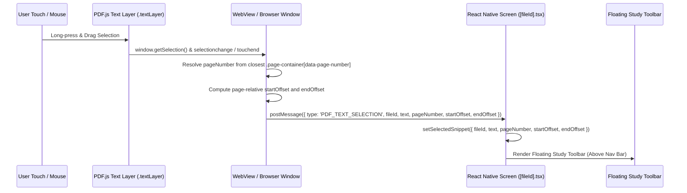
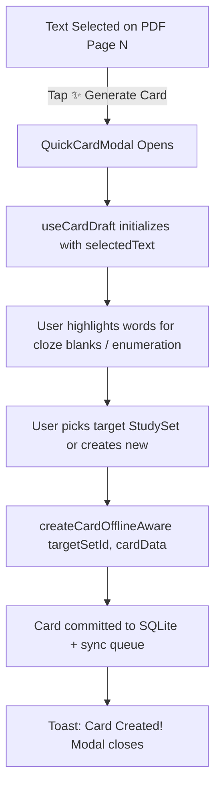

# Saulado Offline PDF Reader + Text Selection + Add To Bag — Design Spec

**Date:** 2026-09-12  
**Status:** Approved Specification  
**Scope:** Mobile app (`mobile/`) and Web frontend (`frontend/`), with platform-agnostic contracts in `@saulado/shared`.  
**Architecture Paradigm:** Visual-First Canvas + Text Layer Overlay, Lightweight Persistence, Reusing Existing Saulado Study Pipelines (`FileRepository`, `SnippetBagStore`, `createCardOfflineAware`).

---

## 1. Goal & Philosophy

Transform PDF files inside Saulado into direct, offline-first sources of study cards without requiring DOCX conversion, third-party document processing APIs, or heavy text-coordinate databases.

### Core MVP Workflow

```txt
Open PDF
   ↓
Select Text (Visual Canvas + Text Layer)
   ↓
Floating Study Toolbar [ 👜 Add To Bag | ✨ Generate Card | 📌 Highlight | ✕ ]
   ↓
Bag Studio / Quick Card Modal
   ↓
Active Recall Study Session (100% Offline via createCardOfflineAware)
```

### Key Principles

1. **Strict MVP Scope**: Focus entirely on: Open PDF → Select Text → Study Toolbar (Add to Bag, Generate Card, Highlight). Reader Mode, deep linking, and advanced annotation tools are deferred.
2. **Visual PDF as Source of Truth**: The original PDF canvas preserves all equations, diagrams, tables, multi-column layouts, and typography.
3. **Text Layer for Interaction Only**: Transparent PDF.js text layer mapped 1:1 over canvas enables native OS/browser selection handles, drag gestures, and highlights.
4. **No Heavy Database Bloat**: We avoid storing tens of thousands of `PdfTextBlock` records. Text extraction is performed on-demand by PDF.js; the PDF file in `FileRepository` remains the persistent source of truth.
5. **Unified Study Pipeline**: PDF selections flow directly into the existing `SnippetBagStore`, `BagStudio`, and `createCardOfflineAware` pipeline alongside typed and OCR text.
6. **Independence of Bag & Card Generation**: Users can add to Bag without generating cards immediately, or generate a card immediately without polluting the Bag. Both reuse `createCardOfflineAware`.
7. **Types Only in `@saulado/shared`**: Keep shared libraries platform-agnostic and free of DOM/Node-specific PDF.js dependencies.

---

## 2. Decisions & Scope Confirmation

| #      | Decision                                                  | Rationale                                                                                                                                                                                     |
| ------ | --------------------------------------------------------- | --------------------------------------------------------------------------------------------------------------------------------------------------------------------------------------------- |
| **D1** | **Visual PDF Canvas + Text Layer is the sole MVP mode**   | Preserves page layout fidelity; Reader Mode is deferred post-MVP.                                                                                                                             |
| **D2** | **PDF.js Text Layer overlay inside WebView / Browser**    | Provides native selection handles, word-boundary snapping, and 100% offline support with zero Hermes engine polyfill issues. Platform quirks isolated in viewer layer.                        |
| **D3** | **No coordinate database in SQLite**                      | Storing bounding boxes for every word causes massive storage and migration bloat. Text is read from the PDF on demand.                                                                        |
| **D4** | **`FileRepository` is the sole document store**           | Files are referenced via `fileId`. No redundant document abstraction layers.                                                                                                                  |
| **D5** | **Study-Focused Toolbar (Strict 3 actions + dismiss)**    | Only `Add To Bag`, `Generate Card`, `Highlight`, and `✕`. No document editor clutter (copy, share, AI rewrite, etc.).                                                                         |
| **D6** | **Robust `PdfTextSelection` & `BaggedSnippet` contracts** | Captures `fileId`, `pageNumber`, `text`, `startOffset?`, `endOffset?`, and `source: 'pdf'` to allow reconnecting snippets to their source page.                                               |
| **D7** | **Reliable, lightweight highlight model**                 | Stored as `{ id, fileId, pageNumber, text, startOffset?, endOffset?, color, createdAt }` in SQLite. Anchored on the text layer during active sessions and re-applied when offsets/text match. |
| **D8** | **Bounded Page Rendering (No 300-canvas explosion)**      | Only render active page (plus adjacent page preload buffer) and release unused canvas contexts immediately to prevent mobile OOM.                                                             |
| **D9** | **Scanned PDF Detection**                                 | When `textContent.items.length === 0`, display non-blocking notice: _"This page doesn't contain selectable text."_ No redundant OCR engine introduced.                                        |

---

## 3. Data Models & Contracts (`@saulado/shared`)

### 3.1 Selection Contract (`shared/src/repository/types.ts`)

```typescript
export interface PdfTextSelection {
  fileId: string
  pageNumber: number
  text: string
  startOffset?: number
  endOffset?: number
  source?: 'pdf'
}
```

### 3.2 Snippet Bag Model (`shared/src/repository/types.ts`)

```typescript
export type SnippetSource = 'pdf' | 'docx' | 'doc' | 'ocr' | 'typed'

export interface BaggedSnippet {
  id: string
  fileId: string
  fileName: string
  fileType: 'pdf' | 'docx' | 'doc'
  source: SnippetSource
  text: string
  pageNumber?: number // 1-indexed page number for PDFs
  startOffset?: number // Optional character/span offset within the page
  endOffset?: number // Optional character/span offset within the page
  sourceParagraphIndex?: number // For DOCX paragraphs
  createdAt: string
}
```

### 3.3 Lightweight Highlight Model (`shared/src/repository/types.ts`)

```typescript
export interface PdfHighlight {
  id: string
  fileId: string // References RepositoryFile.id
  pageNumber: number
  text: string
  startOffset?: number // Optional anchor offset within the page's text layer
  endOffset?: number // Optional anchor offset within the page's text layer
  color: 'yellow' | 'green' | 'emerald' | 'rose'
  createdAt: string
}
```

---

## 4. Toolbar Interaction Design

When the user selects text on any PDF page, a floating pill toolbar appears safely anchored above the bottom navigation / safe area:

```txt
┌────────────────────────────────────────────────────────┐
│  TEXT SELECTED · PAGE 4                                │
│  "Mitochondria are the powerhouse of the cell..."      │
│                                                        │
│  [ 👜 Add To Bag ]   [ ✨ Generate Card ]   [ 📌 Highlight ]   [ ✕ ]
└────────────────────────────────────────────────────────┘
```

### Button Behaviors

1. **`👜 Add To Bag`**:
   - Saves snippet to `useSnippetBagStore`:
     ```typescript
     addSnippet({
       fileId: file.id,
       fileName: file.name,
       fileType: 'pdf',
       source: 'pdf',
       text: selectedSnippet.text,
       pageNumber: selectedSnippet.pageNumber,
       startOffset: selectedSnippet.startOffset,
       endOffset: selectedSnippet.endOffset,
     })
     ```
   - Displays confirmation toast: `Bagged "Mitochondria are the..."`
   - Increments persistent Bag badge counter.
   - Clears selection and dismisses toolbar.

2. **`✨ Generate Card`**:
   - Opens immediate `QuickCardModal` over the PDF viewer.
   - Pre-fills draft paragraph with `selectedSnippet.text`.
   - User highlights blanks with `HighlightEditor` (or toggles enumeration).
   - User picks target study set and taps "Save Card".
   - Calls `createCardOfflineAware(targetSetId, { paragraph, answers })`.
   - Card is committed directly to SQLite and sync queue.
   - Clears selection and dismisses toolbar. (Does NOT require adding to Bag).

3. **`📌 Highlight`**:
   - Inserts record into local SQLite `file_highlights` table.
   - Wraps the active text selection with `<mark class="pdf-highlight ${color}">` in the rendered text layer DOM.
   - Displays confirmation toast: `Highlighted on Page N`.
   - Clears selection and dismisses toolbar.

4. **`✕` (Dismiss)**:
   - Clears selection state and removes toolbar without performing any action.

---

## 5. PDF Selection Event Flow & WebView Architecture



### Robust Text Layer & Selection Mechanics

1. **Text Layer Alignment**:
   - PDF.js renders `<canvas id="pdf-canvas">` with `viewport = page.getViewport({ scale })`.
   - Overlay `<div class="textLayer">` sized identically to canvas using PDF.js standard CSS transforms.
   - Spans are positioned absolutely with exact font sizes, horizontal scaling, and transparent text fill.
2. **Platform Selection Normalization (Android WebView, iOS WebView, React Native Web)**:
   - CSS: `user-select: text; -webkit-user-select: text; touch-action: pan-y;` on the text layer.
   - Debounce `selectionchange` (100ms) and hook `touchend` / `mouseup` to ensure handles have settled.
   - Compute character offsets relative to the page's aggregated text spans for stable anchoring.
3. **Scanned PDF Handling**:
   - When `textContent.items.length === 0`, emit `PDF_SCANNED_PAGE` message.
   - Displays a non-blocking toast: _"This page doesn't contain selectable text."_

---

## 6. Snippet Bag & Bag Studio Integration

### 6.1 Snippet Bag Store (`mobile/stores/snippet-bag.ts`)

- Removes hardcoded `fileType: 'docx' | 'doc'` restrictions.
- Updates `hasSnippet`:
  ```typescript
  hasSnippet: (fileId, text, pageNumber) => {
    const trimmed = text.trim()
    return get().snippets.some(
      (s) =>
        s.fileId === fileId &&
        s.text.trim() === trimmed &&
        (pageNumber === undefined || s.pageNumber === pageNumber),
    )
  }
  ```
- Deduplicates on `fileId`, `text`, and `pageNumber`.

### 6.2 Snippet Bag Modal (`mobile/components/snippet-bag-modal.tsx`)

- Displays `PDF · Page N` badge beside document name.
- Removes legacy notice _"PDF files are excluded from snippet bagging"_.

### 6.3 Bag Studio Wizard (`mobile/app/(app)/files/bag-studio.tsx`)

- Displays `Card X of Y · [Document Name] · Page N`.
- Converts snippets to cards via `useCardDraft` + `HighlightEditor` and persists with `createCardOfflineAware`.

---

## 7. Direct Quick Card Generation Flow (`QuickCardModal`)



---

## 8. Lightweight Highlight Persistence Strategy

### 8.1 SQLite Schema (`mobile/lib/offline/db.ts`)

```sql
CREATE TABLE IF NOT EXISTS file_highlights (
  id TEXT PRIMARY KEY NOT NULL,
  file_id TEXT NOT NULL,
  user_id TEXT NOT NULL,
  page_number INTEGER NOT NULL,
  text TEXT NOT NULL,
  start_offset INTEGER,
  end_offset INTEGER,
  color TEXT NOT NULL DEFAULT 'yellow',
  created_at TEXT NOT NULL,
  FOREIGN KEY (file_id) REFERENCES repository_files(id) ON DELETE CASCADE
);

CREATE INDEX IF NOT EXISTS idx_highlights_file ON file_highlights (file_id, page_number);
```

### 8.2 Highlight Service (`mobile/services/highlights.ts`)

- `getHighlights(fileId: string): Promise<PdfHighlight[]>`
- `saveHighlight(highlight: Omit<PdfHighlight, 'id' | 'createdAt'>): Promise<PdfHighlight>`
- `deleteHighlight(id: string): Promise<void>`

### 8.3 Restoration in PDF Text Layer

- Highlights for the active page are passed into the viewer HTML on load / page switch.
- When `pdfjsLib.renderTextLayer` finishes, an in-layer highlighter inspects the page spans:
  1. Checks if `start_offset` and `end_offset` align.
  2. Fallback: Matches substring `highlight.text` within the page text content.
  3. Wraps matched characters/spans with `<mark class="pdf-highlight ${color}">`.

---

## 9. Large PDF Bounded Rendering Strategy

1. **Bounded Page Lifecycle**:
   - Never render more than 1 page canvas at a time in memory.
   - On page navigation (`prevPage()`, `nextPage()`, or jumping):
     - Cancel any pending `renderTask`.
     - Clear canvas buffer (`ctx.clearRect(0, 0, canvas.width, canvas.height)`).
     - Reset canvas dimensions before rendering new page.
     - Teardown existing `.textLayer` DOM nodes before rendering new text layer.
2. **Offline Assets**:
   - `pdf.min.js` and `pdf.worker.min.js` are served locally from `file:///android_asset/pdfjs/` or bundled assets. Zero network requests required.

---

## 10. Web and Mobile Parity

| Layer             | Mobile                                                | Web                                                 |
| ----------------- | ----------------------------------------------------- | --------------------------------------------------- |
| **Contract**      | `PdfTextSelection`, `BaggedSnippet`, `PdfHighlight`   | `PdfTextSelection`, `BaggedSnippet`, `PdfHighlight` |
| **Viewer**        | `react-native-webview` with PDF.js canvas + textLayer | DOM iframe/object or PDF.js canvas + textLayer      |
| **Selection**     | `PDF_TEXT_SELECTION` postMessage                      | Standard window selection event                     |
| **Study Toolbar** | Floating Native Pill above Bottom Nav                 | Floating Card above Selection / Footer              |
| **Card Pipeline** | `QuickCardModal` + `createCardOfflineAware`           | `MakeCardsDialog` + `createCard` API                |

---

## 11. Testing & Acceptance Matrix

### Automated Tests

1. `packages/shared`: Verify `BaggedSnippet`, `PdfTextSelection`, and `PdfHighlight` contracts.
2. `mobile/stores/__tests__/snippet-bag.test.ts`:
   - Add PDF snippet with `pageNumber`.
   - Verify deduplication on same page vs different pages.
   - Verify source: `'pdf'` persists cleanly in AsyncStorage.
3. `mobile/services/__tests__/highlights.test.ts`:
   - Create, list, and delete highlights in SQLite.
   - Verify isolation across `fileId`.

### Manual & Acceptance Verification

1. Open multi-page PDF in Saulado.
2. Verify visual fidelity: diagrams, columns, fonts preserved.
3. Long-press and select text on Page 3.
4. Verify floating toolbar displays: `Add To Bag`, `Generate Card`, `Highlight`, `✕`.
5. Tap `Add To Bag` → verify toast, badge increments, snippet appears in `SnippetBagModal` with `PDF · Page 3`.
6. Select text and tap `Generate Card` → verify `QuickCardModal` opens, blank words, save offline.
7. Select text and tap `Highlight` → verify mark appears, persists across page navigation and document reload.
8. Test scanned/image-only PDF → verify non-blocking notification appears without crashing.
