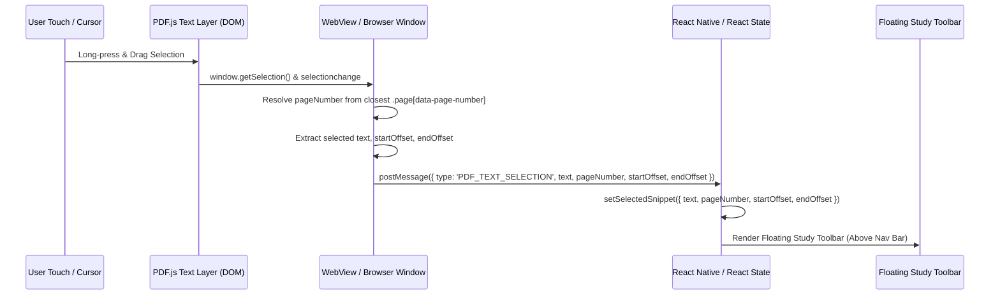

# Saulado Offline PDF Reader + Text Selection + Add To Bag — Design Spec

**Date:** 2026-09-12  
**Status:** In Review (Brainstorming Spec)  
**Scope:** Mobile app (`mobile/`) and Web frontend (`frontend/`), with platform-agnostic contracts in `@saulado/shared`.  
**Architecture Paradigm:** Visual-First Canvas + Text Layer Overlay, Lightweight Persistence, Reusing Existing Saulado Study Pipelines.

---

## 1. Goal & Philosophy

Transform PDF files inside Saulado into direct, offline-first sources of study cards without requiring DOCX conversion, third-party document processing APIs, or heavy text-coordinate databases.

### Core Workflow

```txt
Open PDF
   ↓
Select Text (Visual Canvas + Text Layer)
   ↓
Floating Study Toolbar [ 👜 Add To Bag | ✨ Generate Card | 📌 Highlight ]
   ↓
Bag Studio / Card Engine
   ↓
Active Recall Study Session (100% Offline)
```

### Key Principles

1. **Visual PDF as Source of Truth**: The original PDF canvas preserves all equations, diagrams, tables, multi-column layouts, and typography.
2. **Text Layer for Interaction Only**: Transparent PDF.js text layer mapped 1:1 over canvas enables native OS/browser selection handles, drag gestures, and highlights.
3. **No Heavy Database Bloat**: We avoid storing tens of thousands of `PdfTextBlock` records for 300-page textbooks. Text extraction is performed on-demand by PDF.js; the PDF file in `FileRepository` remains the persistent source of truth.
4. **Unified Study Pipeline**: PDF selections flow directly into the existing `SnippetBagStore`, `BagStudio`, and `createCardOfflineAware` pipeline alongside typed and OCR text.
5. **Types Only in `@saulado/shared`**: Keep shared libraries platform-agnostic and free of DOM/Node-specific PDF.js dependencies.

---

## 2. Decisions & Scope Confirmation

| #      | Decision                                                    | Rationale                                                                                                                                   |
| ------ | ----------------------------------------------------------- | ------------------------------------------------------------------------------------------------------------------------------------------- |
| **D1** | **Visual PDF is default; Reader Mode is non-MVP (Roadmap)** | Preserves page layout fidelity; prevents premature complexity before core workflow is proven.                                               |
| **D2** | **PDF.js Text Layer overlay inside WebView / Browser**      | Provides native OS selection handles, zoom loupe, word-boundary snapping, and 100% offline support with zero Hermes engine polyfill issues. |
| **D3** | **No coordinate database in SQLite**                        | Storing bounding boxes for every word in 100+ page books causes massive storage and migration bloat. Text is read from the PDF on demand.   |
| **D4** | **`FileRepository` is the sole document store**             | Files are referenced via `fileId`. No redundant document abstraction layers.                                                                |
| **D5** | **Study-Focused Toolbar (Strict 3 actions)**                | Only `Add To Bag`, `Generate Card`, and `Highlight`. No document editor clutter (copy, share, AI rewrite, etc.).                            |
| **D6** | **Enriched `BaggedSnippet` metadata**                       | Captures `source: 'pdf'`, `pageNumber`, `startOffset`, and `endOffset` to allow reconnecting snippets to their exact source page.           |
| **D7** | **Lightweight text-based highlights**                       | Stored as `{ id, documentId, pageNumber, text, color }` in SQLite and re-applied to the text layer DOM.                                     |

---

## 3. Data Models & Contracts (`@saulado/shared`)

### 3.1 Snippet Bag Model (`shared/src/repository/types.ts`)

```typescript
export type SnippetSource = 'pdf' | 'docx' | 'doc' | 'ocr' | 'typed'

export interface BaggedSnippet {
  id: string
  fileId: string
  fileName: string
  fileType: 'pdf' | 'docx' | 'doc'
  source: SnippetSource
  text: string
  pageNumber?: number // 1-indexed page number for PDFs
  startOffset?: number // Character offset within the page
  endOffset?: number // Character offset within the page
  sourceParagraphIndex?: number // For DOCX paragraphs
  createdAt: string
}
```

### 3.2 Lightweight Highlight Model (`shared/src/repository/types.ts`)

```typescript
export interface PdfHighlight {
  id: string
  documentId: string // References RepositoryFile.id (fileId)
  pageNumber: number
  text: string
  color?: 'yellow' | 'green' | 'emerald' | 'rose'
  createdAt: string
}
```

---

## 4. Toolbar Interaction Design

When the user selects text on any PDF page, a floating pill toolbar appears safely anchored above the bottom navigation / safe area:

```txt
┌────────────────────────────────────────────────────────┐
│  TEXT SELECTED · PAGE 4                                │
│  "Mitochondria are the powerhouse of the cell..."      │
│                                                        │
│  [ 👜 Add To Bag ]   [ ✨ Generate Card ]   [ 📌 Highlight ]   [ ✕ ]
└────────────────────────────────────────────────────────┘
```

### Button Behaviors

1. **`👜 Add To Bag`**:
   - Saves snippet to `useSnippetBagStore`:
     ```typescript
     addSnippet({
       fileId: file.id,
       fileName: file.name,
       fileType: 'pdf',
       source: 'pdf',
       text: selectedSnippet.text,
       pageNumber: selectedSnippet.pageNumber,
       startOffset: selectedSnippet.startOffset,
       endOffset: selectedSnippet.endOffset,
     })
     ```
   - Displays confirmation toast: `Bagged "Mitochondria are the..."`
   - Increments the persistent Bag badge counter.
   - Clears selection and dismisses toolbar.

2. **`✨ Generate Card`**:
   - Opens an immediate Card Creation Sheet over the PDF.
   - Pre-fills the draft paragraph with the selected text.
   - User taps words to create cloze blanks or selects enumeration mode.
   - User picks target study set and taps "Save Card".
   - Calls `createCardOfflineAware(targetSetId, { paragraph, answers })`.
   - Card is committed directly to SQLite and sync queue.

3. **`📌 Highlight`**:
   - Prompts color pick (default: emerald/yellow).
   - Inserts record into local SQLite `file_highlights` table.
   - Injects a `<mark class="pdf-highlight">` wrapper into the active text layer DOM so it remains visually highlighted during the session.
   - Dismisses toolbar.

4. **`✕` (Dismiss)**:
   - Clears selection state and removes toolbar without action.

---

## 5. PDF Selection Event Flow



### Implementation Details:

- Inside `generatePdfViewerHtml()`:
  ```javascript
  function checkSelection() {
    try {
      const sel = window.getSelection()
      const text = sel ? sel.toString().trim() : ''
      if (!text || text === lastSelectionText) return
      lastSelectionText = text

      const range = sel.getRangeAt(0)
      let container = range.commonAncestorContainer
      if (container.nodeType !== 1) container = container.parentElement
      const pageEl = container.closest('.page-container')
      const pageNumber = pageEl ? parseInt(pageEl.dataset.pageNumber, 10) : pageNum

      if (window.ReactNativeWebView) {
        window.ReactNativeWebView.postMessage(
          JSON.stringify({
            type: 'PDF_TEXT_SELECTION',
            text: text,
            pageNumber: pageNumber,
            startOffset: range.startOffset,
            endOffset: range.endOffset,
          }),
        )
      }
    } catch (e) {
      console.warn('Selection check failed:', e)
    }
  }
  document.addEventListener('selectionchange', checkSelection)
  document.addEventListener('touchend', () => setTimeout(checkSelection, 150))
  ```

---

## 6. Snippet Bag & Bag Studio Integration

### 6.1 Unifying Sources in Snippet Bag Store (`mobile/stores/snippet-bag.ts`)

- Remove hardcoded `fileType: 'docx' | 'doc'` filter.
- Update `hasSnippet`:
  ```typescript
  hasSnippet: (fileId, text, pageNumber) => {
    const trimmed = text.trim()
    return get().snippets.some(
      (s) =>
        s.fileId === fileId &&
        s.text.trim() === trimmed &&
        (pageNumber === undefined || s.pageNumber === pageNumber),
    )
  }
  ```

### 6.2 Snippet Bag Inspection Modal (`mobile/components/snippet-bag-modal.tsx`)

- Display badge showing source type and page number:
  - `PDF · Page 4` (with dedicated icon/badge).
  - `DOCX · Section 2`.
- Update empty state text from `"Word (.docx or .doc) document"` to `"PDF or Word document"`.
- Remove `"PDF files are excluded from snippet bagging"`.

### 6.3 Bag Studio Wizard (`mobile/app/(app)/files/bag-studio.tsx`)

- Header shows: `Card X of Y · [Document Name] · Page N`.
- Uses existing `HighlightEditor` and `useCardDraft`.
- Saves cards via `createCardOfflineAware(targetSetId, { paragraph, answers })`.
- 100% offline persistence to SQLite and automatic sync when network is restored.

---

## 7. Lightweight Highlight Persistence Strategy

### 7.1 SQLite Schema (`mobile/lib/offline/db.ts`)

Add table to SQLite database:

```sql
CREATE TABLE IF NOT EXISTS file_highlights (
  id TEXT PRIMARY KEY NOT NULL,
  file_id TEXT NOT NULL,
  user_id TEXT NOT NULL,
  page_number INTEGER NOT NULL,
  text TEXT NOT NULL,
  color TEXT NOT NULL DEFAULT 'yellow',
  created_at TEXT NOT NULL,
  FOREIGN KEY (file_id) REFERENCES repository_files(id) ON DELETE CASCADE
);

CREATE INDEX IF NOT EXISTS idx_highlights_file ON file_highlights (file_id, page_number);
```

### 7.2 Highlight Service (`mobile/services/highlights.ts`)

- `getHighlights(fileId: string): Promise<PdfHighlight[]>`
- `saveHighlight(highlight: Omit<PdfHighlight, 'id' | 'createdAt'>): Promise<PdfHighlight>`
- `deleteHighlight(id: string): Promise<void>`

### 7.3 Visual Application in PDF.js Text Layer

When PDF.js renders a page, all highlights matching `page_number === current_page` are passed in. A simple text matching helper highlights matching substrings in the rendered text layer nodes with `<mark class="pdf-highlight ${color}">`.

---

## 8. Concrete Implementation Roadmap

### Phase 1: Shared Contracts & Models

- `packages/shared/src/repository/types.ts`:
  - Add `SnippetSource`, `BaggedSnippet`, `PdfHighlight` types.
- `packages/shared/src/repository/index.ts`:
  - Export new types.

### Phase 2: Snippet Bag & Storage Enhancements

- `mobile/stores/snippet-bag.ts`:
  - Incorporate `BaggedSnippet` from `@saulado/shared`.
  - Update `addSnippet`, `hasSnippet`, and persistence logic.
- `mobile/stores/__tests__/snippet-bag.test.ts`:
  - Add unit tests for PDF snippets, page numbers, and deduplication.
- `mobile/lib/offline/db.ts` & `mobile/lib/offline/types.ts`:
  - Add `file_highlights` table migration and type definitions.
- `mobile/services/highlights.ts`:
  - Create CRUD helpers for SQLite highlights.

### Phase 3: Visual PDF Viewer with Text Layer Overlay

- `mobile/services/document-viewer.ts`:
  - Enhance `generatePdfViewerHtml()`:
    - Include PDF.js CSS text layer styling (`.textLayer`, span absolute positioning).
    - Call `page.getTextContent()` and `pdfjsLib.renderTextLayer()`.
    - Add `PDF_TEXT_SELECTION` event postMessage dispatcher.
    - Support injection of persistent highlights into text layer spans.
- `mobile/app/(app)/files/[fileId].tsx`:
  - Remove all PDF exclusions (`file.fileType === 'pdf'` guards).
  - Handle `PDF_TEXT_SELECTION` message.
  - Implement the 3-button floating study toolbar (`Add to Bag`, `Generate Card`, `Highlight`).

### Phase 4: Direct Card Generation Flow

- `mobile/components/quick-card-modal.tsx`:
  - Create lightweight modal/sheet wrapping `HighlightEditor` + `useCardDraft` for immediate single-card creation from selection.
- Connect `✨ Generate Card` in `[fileId].tsx` to `QuickCardModal` saving with `createCardOfflineAware`.

### Phase 5: Bag UI & Bag Studio Updates

- `mobile/components/snippet-bag-modal.tsx`:
  - Display PDF source & page number badges.
  - Remove legacy exclusion notices.
- `mobile/app/(app)/files/bag-studio.tsx`:
  - Update header to display document title & page number.
  - Remove docx-only copy.

### Phase 6: Web Viewer Parity

- `frontend/src/features/files/FileViewerPage.tsx`:
  - Enable PDF selection and "Make Cards" directly from selected text.

---

## 9. Risks, Edge Cases & Performance Considerations

1. **Large Textbooks (100–300 pages) & Memory Management**:
   - **Risk**: Rendering all pages simultaneously causes memory spikes and crashes on mobile.
   - **Mitigation**: Lazy page rendering. Only render the currently visible page (with next/previous page buttons or a bounded virtual viewport). Destroy previous `<canvas>` context before rendering new page.
2. **Scanned / Image-Only PDFs**:
   - **Risk**: Scanned pages contain zero text items in `page.getTextContent()`.
   - **Mitigation**: Detect when `textContent.items.length === 0`. Show a subtle notice: _"This page contains no digital text layer. Use OCR Import to extract text."_
3. **Pinch-to-Zoom vs Selection Conflict**:
   - **Risk**: User attempts to zoom and triggers unwanted text selection, or vice versa.
   - **Mitigation**: TextLayer has `user-select: text; -webkit-user-select: text;`. Container uses viewport meta `user-scalable=yes` with hardware-accelerated zoom scale.
4. **Multi-Column Text Flow**:
   - **Risk**: Selection across columns can combine unrelated paragraphs.
   - **Mitigation**: PDF.js text layer spans use exact CSS transforms corresponding to document geometry. Selections respect DOM hierarchy and boundary bounding boxes.

---

## 10. Future Roadmap (Post-MVP)

- **Phase 7: Reader Mode**: Optional distraction-free Kindle-style structured reading view.
- **Phase 8: Deep Linking**: Tapping a bagged snippet or card source jumps directly to that PDF page.
- **Phase 9: Multi-Color Annotation**: Highlight palette picker with searchable highlight list.
