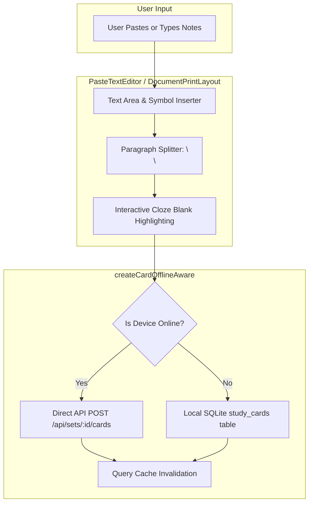

# Architecture & Design Specification: Remove OCR & Implement Paste Text to Cards

**Date:** 2026-09-24  
**Status:** Approved for Implementation (Approach 1)  
**Target Repositories:** Web App (`frontend/`), Mobile App (`mobile/`), Shared Library (`shared/`)

---

## 1. Problem Statement & Motivation

Saulado currently includes OCR modules across both the web app (`tesseract.js` WASM engine) and the mobile app (`@react-native-ml-kit/text-recognition`, `expo-camera`, and `LensArOverlay`).

However:

1. Native OCR adds binary bloat, requires sensitive camera permissions on mobile, and adds latency and failures in poor lighting.
2. Web OCR requires downloading large WASM binaries and language datasets (~4 MB), slowing down initial imports.
3. Users primarily study from digital notes, summaries, PDFs, articles, and textbooks that they can copy-paste.
4. Mobile already has an offline-resilient card generation and cloze highlighting engine (`DocumentPrintLayout` + `createCardOfflineAware`), but it was tucked away as an offline fallback or secondary button behind the camera scanner.

This project removes all OCR modules and dependencies from both web and mobile, making the **"Paste Text to Cards"** creation flow the premier, 100% offline-capable way to generate cloze flashcards from text.

---

## 2. Scope of Changes

### 2.1 Mobile App (`mobile/`)

1. **Remove Native OCR & Camera Dependencies:**
   - Uninstall `@react-native-ml-kit/text-recognition`.
   - Remove `expo-camera` dependency from `mobile/package.json` and permissions plugin from `mobile/app.config.ts`.
   - Remove `expo-image-manipulator` (only used by OCR cropping).
2. **Delete Deprecated OCR Source Files:**
   - `mobile/services/ocr.ts`
   - `mobile/lib/text-recognition.ts`
   - `mobile/components/lens-ar-overlay.tsx`
   - `mobile/app/(app)/scan.tsx`
   - `mobile/lib/scan-handoff.ts`
3. **Dedicated "Paste Notes to Cards" Route (`/paste-cards`):**
   - Create `mobile/app/(app)/paste-cards.tsx` (and keep a lightweight redirect at `scan-review.tsx` and `scan.tsx` so legacy deep links redirect cleanly to `/paste-cards`).
   - Powered by `DocumentPrintLayout` and `createCardOfflineAware`.
   - Allows users to paste or type notes, auto-split on blank lines (`\n\n`), use 1.2.3 enumeration formatting, and interactively highlight words to turn them into cloze blanks.
   - Saves directly to SQLite when offline and synchronizes when online.
4. **UI Navigation Updates:**
   - `mobile/components/tab-bar.tsx`: Center elevated FAB becomes **"Paste Notes"** (using `FileTextIcon`), navigating directly to `/paste-cards` in all states (online and offline).
   - `mobile/app/(app)/_layout.tsx`: Register `paste-cards` screen in `SCREENS` and remove `scan`.
   - `mobile/app/(app)/index.tsx`: Replace "Scan Paper" quick action tile with **"Paste Notes"** -> `/paste-cards`.
   - `mobile/app/(app)/sets/[setId].tsx`: Replace "Scan Note" and "Read a page with the camera" buttons with **"Paste Notes"** -> `/paste-cards?setId=${setId}`.
5. **Clean Up Tests & Mocks:**
   - Update any tests referencing `services/ocr` or scanner routes.

---

### 2.2 Web App (`frontend/`)

1. **Remove Tesseract.js Dependency:**
   - Uninstall `tesseract.js` from `frontend/package.json`.
   - Remove `tesseract.js: false` from root `pnpm-workspace.yaml`.
2. **Delete Deprecated OCR Modules:**
   - `frontend/src/services/ocr/` (all files: `image-ocr.ts`, `document-ocr.ts`, `ocr-service.ts`, `ocr-cleanup.ts`, and test files).
   - `frontend/src/features/cards/ocr.ts`.
   - `frontend/src/features/cards/import/OcrImportPipeline.ts`.
3. **Refactor Import Components into Unified "Paste Text to Cards":**
   - Refactor `OcrToolbar.tsx` -> `TextCardsToolbar.tsx` (retaining quick symbols, clean text, and reset).
   - Refactor `OcrReviewEditor.tsx` -> `PasteTextEditor.tsx` (clean text editor + interactive card cloze highlighting via `CardHighlightEditor.tsx`).
   - Refactor `FileImportDialog.tsx` -> `PasteToCardsDialog.tsx` (keeping `ImportDialog.tsx` exporting it for backwards compatibility).
   - Allow direct text pasting, symbol insertion, auto-splitting questions, and cloze highlighting.
4. **Update Web Pages:**
   - `frontend/src/features/dashboard/DashboardPage.tsx`: Quick action button renamed to **"Paste Notes to Cards"** with `FileTextIcon`, triggering `PasteToCardsDialog`.
   - `frontend/src/features/files/MakeCardsDialog.tsx`: Uses `PasteTextEditor` directly instead of OCR editor.
   - `frontend/src/features/landing/LandingPage.tsx`: Update feature card title from "Document & Image OCR" to "Instant Paste & Cloze Cards".

---

### 2.3 Shared Library (`@saulado/shared`)

1. Re-export clean text formatting functions (`enhanceNotesText` / `enhanceOcrText`, `dewrap`, `segmentParagraphs`) from `@saulado/shared` so no breaking changes occur for existing callers, but clearly document them as text normalization utilities.

---

## 3. Data Flow & Offline Architecture

---

## 4. Verification & Testing Plan

1. **Type Checking:** Run `pnpm typecheck` across root, frontend, and mobile (`npx tsc --noEmit`).
2. **Unit Tests:** Run `pnpm test` (or `vitest run`) in both `frontend` and `mobile`.
3. **Offline Flow Verification:** Verify that card creation in `mobile` functions with `onlineManager.setOnline(false)`, successfully inserting cards into local SQLite and reflecting immediately in set detail views.
4. **Lint & Build:** Run `pnpm lint` and `pnpm build` to confirm no broken imports or dead references exist.
