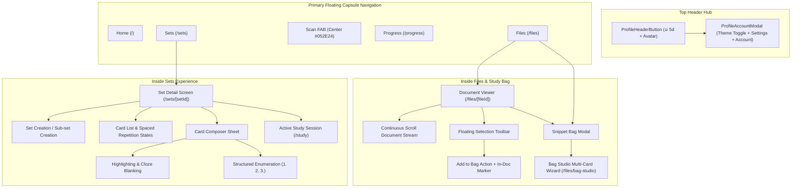
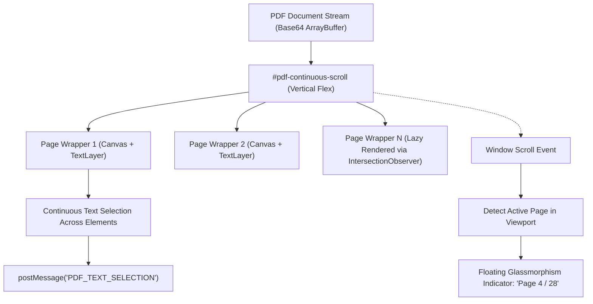

# Saulado Mobile Deep Features & UI/UX Revamp Analysis

**Document Status**: Architectural & UI/UX Specification  
**Scope**: Mobile Deep Screens (`mobile/app/(app)/sets/*`, `mobile/app/(app)/files/*`, `mobile/components/*`)  
**Design System Constraints**: Deep Forest (`#052E24`), Forest (`#317054`), Sage (`#6B9985`), Soft Sage (`#A6C2B5`), Ink (`#111A17`), Surfaces (`#E8F3EE` / `#FAFBF9`), Outfit Display + Manrope UI typography.

---

## 1. System Navigation Map & Tab Hierarchy

The Saulado mobile application is structured around a **5-destination floating capsule tab bar** paired with a unified top-right header hub:



---

## 2. Inside the Sets Experience

### 2.1 Set Creation Flow

#### Current Implementation (`components/set-list.tsx`)

- Handled via an inline dashed border box:
  ```tsx
  <View className="flex-row items-center gap-3 rounded-2xl border border-dashed border-border bg-surface/50 p-3 pl-4">
    <TextInput placeholder="+ Add Subject Deck" ... />
    <Pressable className="bg-primary rounded-full ..."><Text>Create</Text></Pressable>
  </View>
  ```
- Also duplicated inside sub-sets with placeholder `+ Add Sub-set`.

#### Current Gaps & Friction

1. **Lacks Prominence & Hierarchy**: The creation box looks like an empty placeholder or error border rather than a deliberate action.
2. **Zero Metadata or Customization**: Users cannot select a parent folder, category icon, description, or target study goal during creation.
3. **No Preview**: Does not give feedback on how the deck will sit inside "My Subjects & Decks".

#### Target Revamp Specification

- Replace the dashed text box with a dedicated **Elevated Create Deck Trigger & Sheet**:
  - Surface: Crisp container (`#FFFFFF` in light mode, `#111A17` in dark mode) with a subtle `1px` border (`#EEF2EE` / `rgba(255,255,255,0.08)`).
  - Tap opens a clean bottom sheet / card:
    - Deck Title input (Outfit SemiBold, max 100 chars).
    - Subject selector chips (e.g. `Medical Science`, `Language Learning`, `Law`, `Create Subject +`).
    - Color accent tag (Forest, Sage, Emerald, Deep Forest).
    - Primary CTA: Deep Forest `#052E24` capsule button with tactile haptics.

---

### 2.2 Viewing Cards Inside a Deck (`sets/[setId].tsx`)

#### Current Implementation

- Header with set title, offline badge, and 3-dots action menu (`Rename`, `Move`, `Share JSON`, `Archive`, `Delete`).
- Split metric counter: `Cards` count and `Mastered` count.
- Action row: `Study this set` primary button and `+ Card` secondary button.
- Card list rendering `CardRow` components:
  - Text excerpt (`cardLabel(card.paragraph)`).
  - Small uppercase badge (`2 BLANKS`).
  - Unsynced indicator if created offline.
  - Action icons: Move card (`FolderInputIcon`) and Delete card (`TrashIcon`).

#### Current Gaps & Friction

1. **Raw Text Excerpts**: Text is abruptly cut off at 2 lines. Blanks inside the paragraph are invisible in this list (users just see `2 blanks`).
2. **Missing Card Mastery Status**: No indication of whether a specific card is `Due Now`, `Learning`, or `Mastered`.
3. **No Deck Search or Sorting**: Decks with 40+ cards require endless scrolling to find or edit a specific flashcard.

#### Target Revamp Specification

- **Rich Card Tiles**:
  - Background: Surface card with 16px corner radius and subtle 1px border.
  - **Cloze Inline Visualizer**: Display the paragraph with blanks clearly styled as soft green capsules (e.g. `"The [ ••••••• ] artery branches into the..."`).
  - **Spaced-Repetition Status Badge**:
    - `Due Now` (Forest green `#317054` pill with white text).
    - `Learning` (Soft sage `#A6C2B5` / `#E8F3EE` container).
    - `Mastered` (Deep forest `#052E24` badge).
  - Quick action swipe or compact overflow button for Move/Delete.

---

### 2.3 Creating & Authoring Cards (`components/card-composer.tsx`)

#### Current Implementation

- Slide-up bottom sheet modal (`presentationStyle="formSheet"`).
- Keyboard avoiding container with sticky bottom action buttons (`Cancel`, `Add card` / `Save card`).
- Continuous draft persistence via `useCardDraftPersistence` in AsyncStorage.
- Batch creation capability: Saving a card increments the counter `✓ N cards added to this set` and resets the text input without dismissing the composer.

#### Current Gaps & Friction

- Input fields use generic system borders and standard gray backgrounds.
- Toggling between writing text and blanking words requires mental shifting because the text editor and highlight target are two separate views.

---

### 2.4 Editing Features: Highlighting & Structured Enumeration

#### Highlighting Feature (`components/highlight-editor.tsx` & `components/highlight-surface.tsx`)

- **Current Interaction**:
  1. User enters text in a multiline `TextInput`.
  2. As text is entered, a separate read-only container below (`HighlightSurface`) breaks the text into tokenized words.
  3. **Two-Tap Gesture**: User taps word A (it gets "armed" with an underline), then taps word B. The range between A and B becomes a blank.
  4. **Double-Tap Gesture**: Double-tapping a word blanks that single word immediately.
  5. Active blanks appear as removable pill badges: `1. [word] ✕`.
- **Friction Points**:
  - The typing area and the blanking surface are visually separate, forcing the user to scroll up and down.
  - Active blank badges look like plain system buttons with raw `✕` characters.

#### Enumeration Feature (`1. 2. 3. Enumeration`)

- **Current Interaction**:
  - Toggled via `1. 2. 3. Enumeration` button or via text selection popup `📋 Format as Enumeration`.
  - Splits into two structured inputs:
    1. **Topic / Question Prompt** (`enumTitle`).
    2. **List of Enumerated Items** (`enumItems`), each with a fixed numbered badge (`1.`, `2.`, `3.`), delete button `✕`, and `+ Add Next Item`.
  - Automatically compiles items into a cloze card via `compileEnumeration()`.
- **Friction Points**:
  - The floating selection bar is currently an unstyled dark bar (`bg-foreground`) that doesn't fit the visual theme.
  - Numbered inputs lack smooth reordering or drag-and-drop affordances.

#### Target Revamp Specification for Editor

- **Unified Live Highlighting Canvas**:
  - Tap any word directly in the note to toggle a blank without needing a disconnected preview area.
  - Blanks highlighted in glowing emerald/sage tints (`rgba(49, 112, 84, 0.18)`).
- **Modern Structured Enumeration UI**:
  - Forest-tinted circular badges with bold digits:
    ```
    ┌────────────────────────────────────────────────────────┐
    │  TOPIC PROMPT                                          │
    │  [ Three Branches of the Aortic Arch...             ]  │
    ├────────────────────────────────────────────────────────┤
    │  (1) [ Brachiocephalic artery                    ] [✕] │
    │  (2) [ Left common carotid artery                ] [✕] │
    │  (3) [ Left subclavian artery                    ] [✕] │
    │  [ + Add Next Item ]                                   │
    └────────────────────────────────────────────────────────┘
    ```
  - Floating selection action redesigned as a Deep Forest pill (`#052E24`) with clean typography.

---

## 3. Files Tab & Continuous Document Viewing

### 3.1 The Document Viewer Problem: Page-by-Page Bottleneck

In [`services/document-viewer.ts`](file:///c:/projects/saulado/mobile/services/document-viewer.ts#L325-L337), PDF rendering currently uses:

```html
<div id="controls">
  <button id="prev" onclick="prevPage()">‹ Prev</button>
  <span id="page-info"
    >Page <span id="current-page">1</span> of <span id="total-pages">…</span></span
  >
  <button id="next" onclick="nextPage()">Next ›</button>
</div>
<div id="pdf-container">
  <div id="canvas-wrapper" class="page-wrapper">
    <canvas id="pdf-canvas"></canvas>
    <div id="text-layer" class="textLayer"></div>
  </div>
</div>
```

#### Why Page-by-Page Fails Modern Mobile UX:

1. **Unnatural Reading Experience**: Modern mobile readers (Kindle, Apple Books, PDF Expert) offer smooth vertical scrolling.
2. **Context Loss Across Page Boundaries**: Sentences that span across pages cannot be selected together.
3. **Repetitive Tapping**: In a 50-page lecture note, tapping `Next ›` 49 times creates severe fatigue.

---

### 3.2 Continuous Scrollable Document Viewer Architecture

To implement **scrollable, continuous file viewing**:



#### Key Technical Requirements:

1. **Continuous Canvas Stacking**:
   - Every page renders inside its own `.page-wrapper` vertically stacked with `margin: 12px 0`.
   - Native touch scrolling flows uninterrupted through the entire document length.
2. **Lazy Viewport Rendering (Memory Optimization)**:
   - For large PDFs (30+ pages), rendering all canvases simultaneously will crash mobile WebViews.
   - Implement an `IntersectionObserver`:
     - Render canvas & text layer when a page comes within 1.5 screen heights of the viewport.
     - Unload canvas bitmaps when pages scroll far outside the visible area, keeping placeholder `min-height` so layout never jumps.
3. **Floating Minimalist Page Indicator**:
   - Remove the fixed top navigation bar.
   - Render a floating capsule at bottom-center: `Page 3 of 15`.
   - Auto-updates as the user scrolls, fading out after 2 seconds of inactivity.

---

## 4. Study Bag & "Add to Bag" Feature UI

### 4.1 In-Document Selection Toolbar

#### Current Implementation (`app/(app)/files/[fileId].tsx`)

- When text is selected in the WebView, a bottom card appears:
  - Text excerpt: `"{currentSelection.text}"`
  - 3 actions: `Highlight 📌`, `Card ✨`, `+ Add to Bag 🛍️`.
- Uses a dark rectangle (`bg-neutral-900/95`) that clashes with the forest color scheme.

#### Target Revamp Specification

- Floating Deep Forest capsule bar (`#052E24`) with rounded 24px radius, subtle border (`rgba(255,255,255,0.15)`), and 3 elevated actions:
  ```
  ┌────────────────────────────────────────────────────────┐
  │  "The sinoatrial node is the natural pacemaker..."     │
  ├────────────────────────────────────────────────────────┤
  │  [ 📌 Highlight ]   [ ✨ Instant Card ]   [ 🛍️ + Add to Bag ] │
  └────────────────────────────────────────────────────────┘
  ```
- **In-Document Visual Marker**:
  - When text is added to the bag, the document text layer receives an instant **persistent soft-sage highlight (`rgba(49, 112, 84, 0.20)`) with a subtle `🛍️` badge**.
  - Prevents the user from accidentally clipping the same paragraph twice.

---

### 4.2 Snippet Bag Modal (`components/snippet-bag-modal.tsx`)

#### Current Implementation

- Page-sheet modal listing all bagged snippets.
- Displays file title, page number tag, word count, delete icon, and inline text editing.
- Action: `Proceed to Card Creation (N items) →` navigates to `/files/bag-studio`.

#### Target Revamp Specification

- Surface in light `#FAFBF9` / dark `#050D0A`.
- **Multi-Select & Merge Support**: Checkboxes next to snippets allowing users to select 2 or 3 snippets and tap `Merge into 1 Card`.
- Clean card item tiles matching the design system.

---

### 4.3 Bag Studio Screen (`app/(app)/files/bag-studio.tsx`)

#### Current Implementation

- Step 1: Destination set picker (`SetList`).
- Step 2: Sequential step-by-step card editor using `HighlightEditor`.
- Step 3: Batch commit to SQLite and query invalidation.

#### Target Revamp Specification

- **Progress Stepper**: Polished dot bar (`● ● ● ○ ○`) with deck badge.
- **Smart Cloze Proposer**: Proposes initial blank candidates automatically based on capitalized nouns or keywords.
- **Fluid Swipe Gestures**: Swipe left to advance to the next snippet, swipe right to return to the previous snippet.

---

## 5. UI/UX Specification Matrix

| Component / Screen           | Current Implementation                                  | Revamped Target State                                                                   | Color & Geometry Tokens                                          |
| :--------------------------- | :------------------------------------------------------ | :-------------------------------------------------------------------------------------- | :--------------------------------------------------------------- |
| **Set Creation**             | Inline dashed input in deck list                        | Dedicated bottom sheet modal with subject tag selection & preview                       | `#FFFFFF`/`#111A17` card, `#052E24` button, 16px radius          |
| **Deck Detail Cards**        | Plain 2-line text rows with blank count                 | Rich flashcard preview with highlighted cloze blanks and spaced-repetition status badge | `#E8F3EE` surface, `#317054` Due badge, `#052E24` Mastered badge |
| **Card Highlight Editor**    | Two-tap gesture on disconnected surface                 | Unified interactive live text canvas with direct word taps                              | Emerald/Sage highlight spans, `#052E24` numbered blank pills     |
| **Enumeration Mode**         | Generic plain inputs with raw text labels               | Structured cards with forest-tinted numbered circular badges (`1.`, `2.`, `3.`)         | `#052E24` number circles, `#FAFBF9` input surfaces               |
| **Document Viewer**          | **Page-by-page** (`Prev`/`Next` buttons, single canvas) | **Continuous vertical scroll stream** with lazy viewport rendering                      | Full-bleed continuous canvases, floating glassmorphism page pill |
| **Add to Bag Toolbar**       | Generic dark rectangle (`#171717`)                      | Floating Deep Forest capsule bar with tactile icons and clear haptic feedback           | `#052E24` background, `#A6C2B5` icon strokes, 24px radius        |
| **In-Document Bagged State** | Disappears once dismissed                               | Visual soft mint highlight (`rgba(49,112,84,0.18)`) with `🛍️` marker                    | Persistent visual feedback preventing duplicate clips            |
| **Study Bag Modal**          | Basic list modal                                        | Curated drawer with snippet merging (`Merge into 1 Card`) and clean badges              | Soft sage badge (`#E8F3EE`), `#317054` text                      |
| **Bag Studio**               | Rigid sequential wizard                                 | Fluid card studio with smart cloze proposals and swipe navigation                       | Progress stepper, Outfit SemiBold headings, Manrope body         |

---

## 6. Phased Implementation Roadmap

To maintain stability and enable isolated testing, the revamp is structured into 4 sequential execution milestones:

### Milestone 1: Continuous Document Viewer & Selection Toolbar

1. Refactor `services/document-viewer.ts`:
   - Replace single-page canvas with continuous vertical page wrappers.
   - Implement `IntersectionObserver` lazy rendering to keep memory footprint light.
   - Add floating dynamic page counter pill (`Page 3 of 15`).
2. Redesign `Floating Selection Toolbar` in `files/[fileId].tsx`:
   - Implement Deep Forest capsule (`#052E24`).
   - Add in-document bagged visual persistence (`rgba(49, 112, 84, 0.18)`).

### Milestone 2: Sets Detail, Card Rows & Set Creation Sheet

1. Refactor `components/set-list.tsx`:
   - Replace dashed inline input with an elevated Create Set bottom sheet.
2. Refactor `app/(app)/sets/[setId].tsx`:
   - Upgrade card rows to display cloze blank previews and spaced repetition status tags.
   - Add in-deck search filter pill.

### Milestone 3: Card Authoring (Interactive Highlight & Enumeration UI)

1. Refactor `components/highlight-editor.tsx` and `components/highlight-surface.tsx`:
   - Unify editor into an interactive direct-tap highlighting canvas.
2. Refactor Enumeration Mode:
   - Implement structured cards with bold circular numbered badges.
   - Restyle format selection popover into a branded capsule.

### Milestone 4: Study Bag Modal & Studio Polish

1. Refactor `components/snippet-bag-modal.tsx`:
   - Add multi-snippet select and merge support.
2. Refactor `app/(app)/files/bag-studio.tsx`:
   - Add smooth dot-stepper progress bar and fluid swipe gestures between bagged cards.
